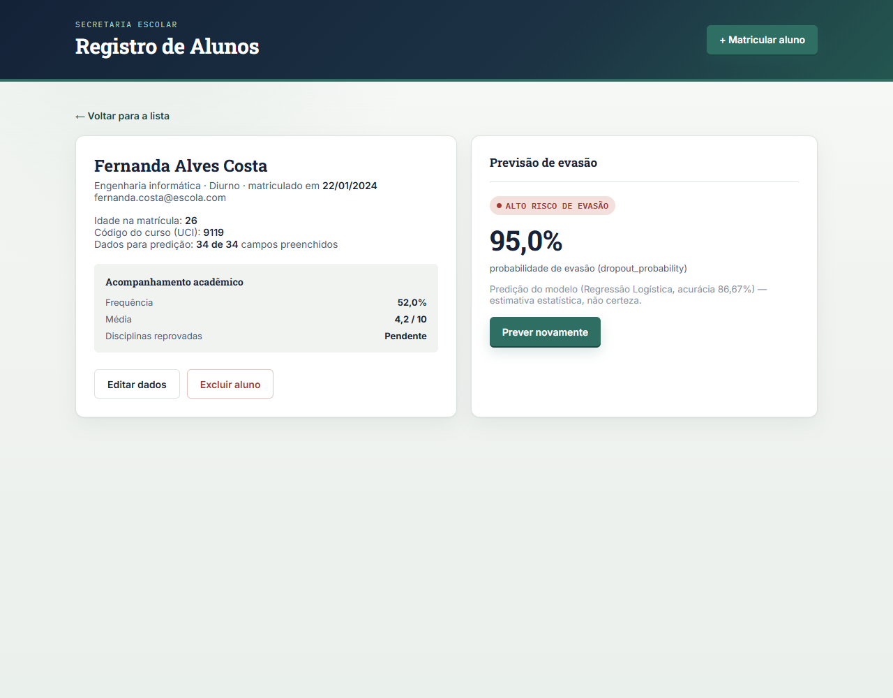

# Plataforma de Gestão de Alunos

Protótipo de front-end para secretaria escolar (cadastro e acompanhamento de alunos), integrado localmente com uma API de Machine Learning (FastAPI + Regressão Logística) para predição de risco de evasão estudantil.

> **Estado atual:** a interface funciona no navegador, persiste os cadastros no `localStorage` e consome a API de predição via requisições HTTP (`fetch`). Quando a API está offline ou inacessível, o risco é exibido como **Predição indisponível**; não existe cálculo nem estimativa de risco local. A API pertence a outro projeto/equipe e **não faz parte deste repositório**.



## Tecnologias utilizadas

- **Linguagens e estrutura:** HTML5, CSS3 e JavaScript puro (Vanilla JS).
- **Armazenamento:** `localStorage` do navegador (sem banco de dados externo ou servidor backend próprio).
- **Sem build:** não utiliza Node.js, npm, bundlers, TypeScript ou frameworks no front-end. Basta abrir o arquivo HTML.

## Funcionalidades

- Listagem de alunos ativos com contadores no dashboard e busca em tempo real por nome ou curso.
- Filtros combinados por nível de risco, turno e curso.
- Matrícula simplificada e edição completa de dados pessoais, acadêmicos e preditivos.
- Formulário de predição estruturado em blocos temáticos com botões de exemplo baseados em dados reais.
- Ficha individual detalhada com exibição da probabilidade de evasão, classificação de risco e aviso de responsabilidade do modelo.
- Previsão em lote (`batch`) para a listagem com cache em memória (chave: ID + hash dos atributos).
- Exclusão de cadastros.
- Indicador de status da API no cabeçalho (`GET /health`: online, offline ou modelo não carregado); clique para verificar novamente.
- Backup: **Exportar dados** (JSON) e **Importar dados** com validação completa e escolha entre mesclar (por id) ou substituir.

## Como executar

### 1. API de predição (projeto externo)

> **Importante:** a API de predição pertence a outra pessoa e **NÃO** está neste repositório.

Para subir a API localmente (PowerShell/Bash na pasta onde o serviço foi clonado/extraído):

```powershell
# Ative o ambiente virtual da API
.\.venv\Scripts\Activate.ps1   # Windows
# source .venv/bin/activate    # Linux/macOS

# Suba o servidor Uvicorn na porta 8000
python -m uvicorn app.main:app --host 127.0.0.1 --port 8000
```

Verifique em `http://127.0.0.1:8000/health` se o status retornado é `"healthy"` e `model_loaded: true`. A API possui CORS liberado (`allow_origins="*"`) e suporta requisições vindas de `file://` (`Origin: null`).

### 2. Front-end

Não requer instalação de dependências ou servidor HTTP:

- Abra diretamente o arquivo `gestao-alunos.html` em qualquer navegador moderno; ou
- Abra a pasta no VS Code e pressione `F5` (configuração em `.vscode/launch.json`).

### Configuração do endereço da API

O endereço da API está configurado na constante **`API_BASE_URL`**, localizada no topo de **[`script.js`](script.js)**:

```javascript
var API_BASE_URL = "http://127.0.0.1:8000";
```

Para apontar para uma API rodando em outra máquina na rede ou em servidor remoto, basta alterar o valor dessa constante (ex.: `"http://192.168.1.50:8000"`). Lembre-se de iniciar o Uvicorn da API com `--host 0.0.0.0` para receber conexões externas.

## Estrutura do projeto

```text
/
├── gestao-alunos.html       # Estrutura HTML da aplicação e modais
├── catalogos.js             # Tabelas de códigos UCI/rótulos e perfis de exemplo reais
├── script.js                # Lógica da interface, cache, validação e cliente HTTP da API
├── style.css                # Estilização visual, layout e responsividade
├── README.md                # Documentação técnica e guia de continuidade
├── docs/
│   └── predicao.png         # Screenshot de evidência da predição na ficha do aluno
└── .vscode/
    └── launch.json          # Configuração de depuração no Chrome via VS Code
```

## Contrato da API e esquema de dados

O modelo de inferência exige **34 atributos** em formato `snake_case` (tipos `int` e `float`).

- **Definição do esquema:** no array **`CAMPOS_PREDICAO`** em [`script.js`](script.js). Cada entrada centraliza metadados (chave, rótulo, tipo, limites min/max, catálogo e agrupamento) e alimenta a renderização do formulário, a validação de completude e a montagem do JSON.
- **Montagem do payload:** na função **`montarPayload(aluno)`** em [`script.js`](script.js).
- **Obrigatoriedade:** embora a API FastAPI defina valores padrão e responda `HTTP 200` mesmo com corpo vazio `{}` ou incompleto, o front-end trata **todos os 34 campos como estritamente obrigatórios**. Se qualquer campo faltar, a requisição é bloqueada para impedir predições fictícias decorrentes de defaults silenciosos.

### Endpoints consumidos

| Método | Caminho | Utilização no front-end |
|---|---|---|
| `GET` | `/health` | Verificação manual da integridade do modelo. |
| `POST` | `/predict` | Predição pontual na ficha individual (`preverRisco(aluno)`). |
| `POST` | `/predict/batch` | Predição em lote na listagem geral (`preverLote(alunos)`), enviando `{"students": [...]}`. |

## Decisões críticas de arquitetura

1. **Bloqueio de predição com dados incompletos:**
   - *Motivo:* a API aceita JSONs incompletos ou vazios e responde `HTTP 200 OK` gerando uma probabilidade padrão (~37,79%). Portanto, status `200` não comprova predição genuína. O front valida os dados antes do envio e impede chamadas incompletas, exibindo "Dados incompletos" e listando exatamente os campos pendentes.
2. **Conversão de códigos categóricos (UCI → Índice 1..N):**
   - *Regra:* os 8 campos categóricos nominais (`course`, `application_mode`, `previous_qualification`, `nationality`, `mothers_qualification`, `fathers_qualification`, `mothers_occupation`, `fathers_occupation`) são convertidos para o índice da sua posição (base 1) na ordem do catálogo de [`catalogos.js`](catalogos.js) pela função `converterCodigoUciParaIndice()` em [`script.js`](script.js).
   - *Motivo:* o manual da API orienta o envio do código original da UCI (ex.: curso 9119 para Engenharia Informática), mas o modelo foi treinado sobre um dataset onde essas colunas foram reindexadas de 1 a N. O envio direto do código UCI satura os pesos da Regressão Logística, gerando resultados extremos espúrios (ex.: 100% de risco).
   - *Status da regra:* **hipótese confirmada por verificação empírica externa** (o dataset de treino possui contagens e valores distintos que coincidem exatamente com 1..N de cada catálogo, e o envio dos índices reproduz as predições reais do CSV). Não há testes automatizados salvos dentro deste repositório; a regra deve ser formalmente confirmada com o responsável pelo modelo em caso de retreinamento.
3. **Mapeamento de níveis de risco:**
   - Os níveis textuais retornados pela API são mapeados em [`script.js`](script.js) (`NIVEL_API`):
     - `"Baixo Risco"` (< 40%) → classe visual `low` ("Risco baixo");
     - `"Médio Risco"` (40% a 69%) → classe visual `mid` ("Risco médio");
     - `"Alto Risco de Evasão"` (>= 70%) → classe visual `high` ("Risco alto").
4. **Ausência de fallback local:**
   - Não há estimativa de risco calculada no cliente. Caso a API esteja inacessível ou falhe, o sistema exibe "Predição indisponível", garantindo que nenhuma métrica enganosa seja apresentada ao usuário.

## Limitações e pendências conhecidas

- **Armazenamento puramente local:** os dados residem apenas no `localStorage` daquele navegador e máquina específica.
- **Sem autenticação:** a plataforma não possui login ou controle de permissões de acesso.
- **Dependência temporal dos dados:** o modelo exige notas e métricas do 1º e 2º semestres letivos, impossibilitando predições reais no ato imediato da matrícula.
- **Ausência de suíte de testes no repositório:** as validações foram executadas via scripts auxiliares pontuais; o repositório não inclui testes unitários ou de integração integrados a pipeline.
- **Origem dos dados macroeconômicos:** taxas de desemprego, inflação e PIB dependem de inserção manual na interface ou de botões de demonstração.

## Histórico e controle de versões (Git Tags)

Para navegar entre versões estáveis do projeto registradas no histórico:

- **`v1-prototipo`**: primeira versão funcional da interface com mock de dados, ordenação e filtros no dashboard, sem integração com a API.
- **`v2-integracao-api`**: integração com a API FastAPI (`/predict` e `/predict/batch`), catálogos completos da UCI, formulário de 34 campos e tratamento de erros.
- **`v3-qualidade`**: versão atual com indicador de status da API no cabeçalho (health-check em `/health`), exportação e importação de backups JSON com validação estrita, e suíte de testes de regressão local.

### Como restaurar ou inspecionar uma tag

Para explorar uma versão antiga sem perder o trabalho atual:

```bash
# Cria uma nova branch a partir da tag desejada
git switch -c recuperacao v1-prototipo

# Para voltar à branch principal atualizada
git switch main
```

## Como continuar o desenvolvimento em outro computador

1. Clone o repositório:
   ```bash
   git clone https://github.com/hugomtfdev/plataforma-alunos.git
   cd plataforma-alunos
   ```
2. Abra `gestao-alunos.html` no navegador.
3. Obtenha a API de predição com seu responsável e inicie-a localmente em `http://127.0.0.1:8000`.
4. Crie uma branch de trabalho para as novas alterações:
   ```bash
   git switch -c dev-casa
   ```

## Contexto rápido para agentes de IA

Caso retome esta tarefa em uma nova conversa com um assistente de IA, forneça este resumo:

> - **Stack:** HTML/CSS/JS puro (sem build, sem framework), persistência em `localStorage`.
> - **Endereço da API:** constante `API_BASE_URL` no topo de `script.js` (espera `http://127.0.0.1:8000`). A API roda externamente em FastAPI e não está neste repo.
> - **Payload estrito:** 34 campos snake_case definidos em `CAMPOS_PREDICAO`. Função `montarPayload(aluno)` em `script.js`. Nunca envie dados incompletos ou vazios (a API responderia 200 com predição falsa baseada em valores padrão).
> - **Códigos categóricos:** o modelo espera a posição 1..N do código no catálogo de `catalogos.js`, e não o código UCI puro (o envio do código UCI satura o modelo). A conversão é feita por `converterCodigoUciParaIndice()` em `script.js`.
> - **Sem fallback:** falhas da API devem exibir "Predição indisponível", nunca calcular risco local.
